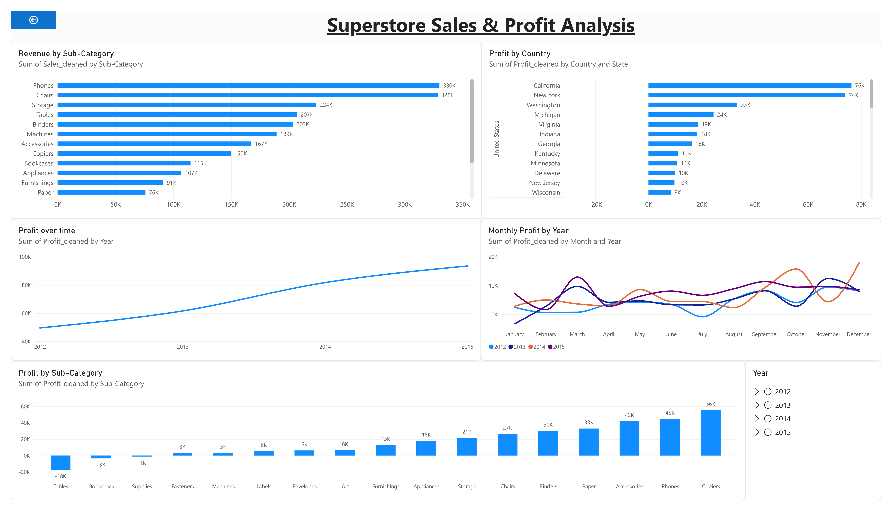

# Superstore: analisi delle vendite e degli utili

[English](README.md) · **Italiano**

Quali prodotti generano più ricavi e dove si concentrano le perdite? Questo progetto di portfolio usa SQLite per analizzare gli ordini del dataset *Global Superstore 2016* e Power BI per esplorare i risultati per prodotto, area geografica e periodo.

## Dashboard

[Visualizza la dashboard in PDF](powerbi/Superstore_dashboard.pdf) · [Apri il file Power BI](powerbi/Superstore_dashboard.pbix)

## Domande di analisi

1. Quali sottocategorie generano più ricavi?
2. Quali paesi e stati registrano gli utili più alti e più bassi?
3. Come varia l’utile da un anno all’altro?
4. L’andamento mensile presenta una stagionalità ricorrente?
5. In quali sottocategorie e prodotti si concentrano le perdite?

## Risultati principali

- I telefoni (*Phones*) hanno generato i ricavi più alti e le etichette (*Labels*) quelli più bassi.
- Stati Uniti, Cina e India hanno registrato gli utili complessivi più elevati. La Turchia ha registrato il valore più basso.
- L’utile annuo è cresciuto ogni anno dal 2012 al 2015. In tutti e quattro gli anni si osserva una flessione a luglio.
- Considerando le sole vendite in perdita, le perdite maggiori si concentrano nei tavoli (*Tables*), seguiti dalle librerie (*Bookcases*) e dai telefoni (*Phones*).
- A livello di singolo prodotto, la perdita più elevata rilevata riguarda un articolo della sottocategoria *Machines* (macchinari).

## Metodo

**Preparazione dei dati.** Ho importato gli ordini in SQLite, rimosso il simbolo del dollaro e le virgole usate come separatori delle migliaia, quindi convertito i campi `Sales` e `Profit` in valori numerici. Ho uniformato le date dal formato giorno/mese/anno al formato ISO (`AAAA-MM-GG`) e verificato i dati prima dell’analisi.

**Analisi SQL.** Ho aggregato i ricavi per sottocategoria e gli utili per paese e stato. Per studiare l’andamento nel tempo ho calcolato l’utile annuo, la variazione percentuale rispetto all’anno precedente e l’utile mensile per ciascun anno. Per individuare le perdite ho esaminato il risultato netto per sottocategoria, i singoli prodotti in perdita e il contributo di ogni sottocategoria alle perdite lorde.

**Visualizzazione in Power BI.** I cinque grafici mostrano i ricavi e gli utili per sottocategoria, gli utili per area geografica, l’andamento degli utili nel tempo e il confronto mensile tra anni. Nella dashboard interattiva si può passare dalla sottocategoria al singolo prodotto e dal paese allo stato e alla città. I filtri temporali consentono di selezionare anno, trimestre, mese o giorno. Selezionando un elemento in un grafico si filtrano anche gli altri.

**Approfondimento in Python.** Con pandas e un notebook marimo ho esaminato la correlazione tra sconto applicato e utile nella sottocategoria dei tavoli.

## Struttura del repository

| Cartella | Contenuto |
| --- | --- |
| [data](data/) | Informazioni sui dati di partenza |
| [sql](sql/) | Query SQLite per la pulizia dei dati e l’analisi di ricavi, utili e perdite |
| [powerbi](powerbi/) | Dashboard interattiva e versioni statiche in PDF e PNG |
| [python](python/) | Analisi della correlazione tra sconti e utili |

## Strumenti e fonte dei dati

SQL (SQLite), Power BI, Python (marimo e pandas), Git e GitHub. Il dataset *Global Superstore 2016* è disponibile su [Power BI Docs](https://powerbidocs.com/2019/11/28/power-bi-sample-data-set-for-practice/).
